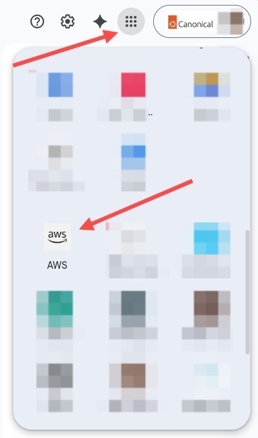
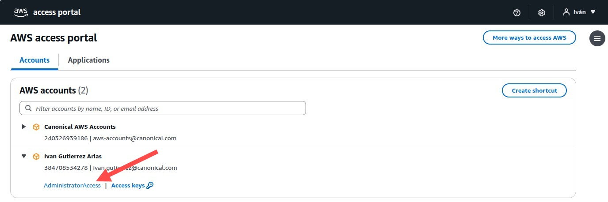
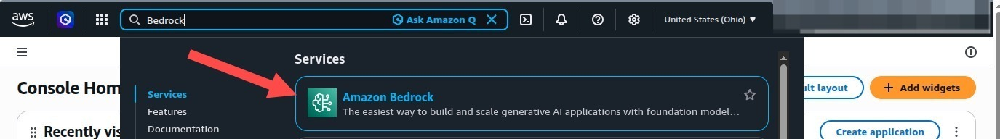
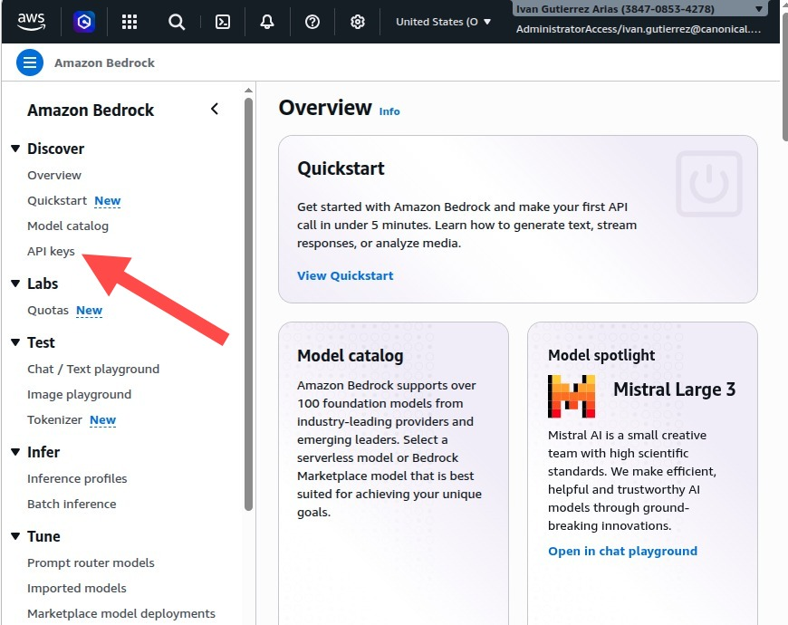
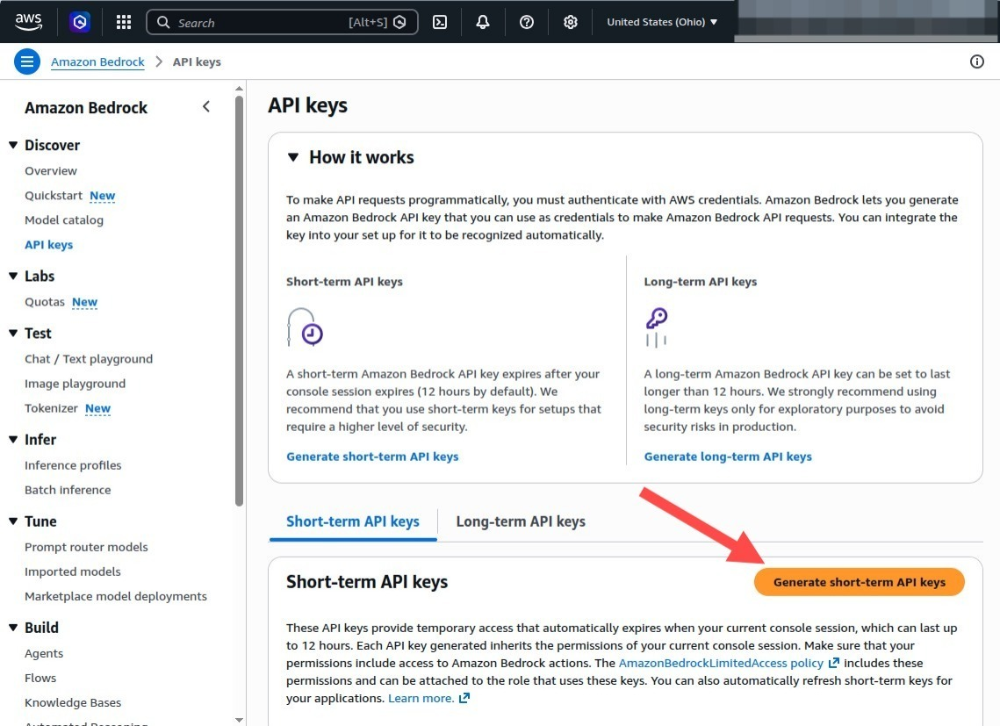
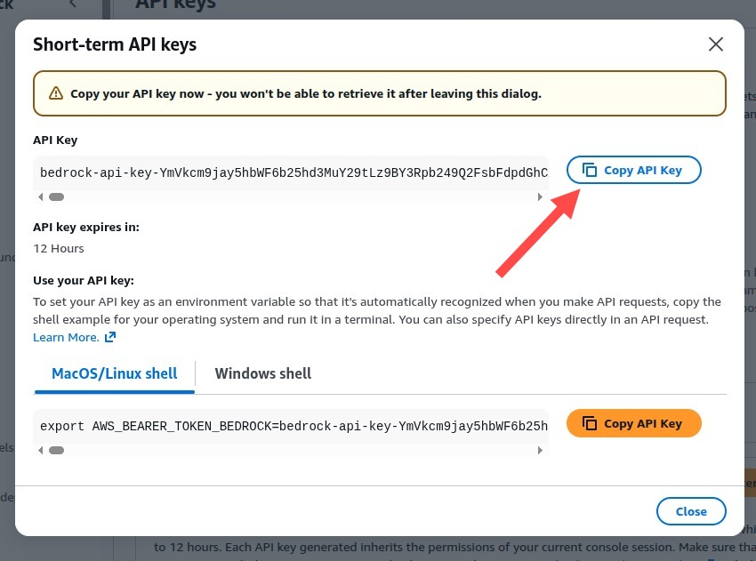

## Rag Snap Bedrock Guide

1. Access your AWS account from your **Google Drive - Google apps** (in the top right corner) and scroll down to **AWS** 

2. On the AWS access portal, use your **AdministratorAccess** in your <your.name>@canonical.com account. 

3. Search for **Amazon Bedrock** 

4. Once in the Amazon Bedrock landing page, click on **[View API keys]** or **[Discover >
API keys]** in: 

5. Now you can click on **[Generate short-term API keys]**. In case you decide to use long-term keys, please be aware of the security implications.

6. Copy your **API key**

7. Set the **snap configuration** and **environment variable** with your API key:

`sudo rag-cli.rag set --package chat.http.host="bedrock-runtime.us-east-2.amazonaws.com"`\
`sudo rag-cli.rag set --package chat.http.port="443"`\
`sudo rag-cli.rag set --package chat.http.tls="true"`\
`sudo rag-cli.rag set --package chat.http.path="openai/v1"`\
`export CHAT_API_KEY="bedrock-api-key-YmVkcm9jay5hbWF6b25hd3MuY29tLY..."`

Note: ensure the API key was generated in the **same AWS region** from your chat.http.host

8. Select a Bedrock OpenAI-compatible model, for example:

`rag-cli.rag chat mistral.mistral-large-3-675b-instruct`

### Using Claude (Sonnet 5.5) instead

Claude models don't support the OpenAI-compatible `…/openai/v1` route used above, so changing the
model name alone fails. On the same `bedrock-runtime` host they support the Anthropic Messages
API at the `anthropic` path, which rag-cli speaks when `chat.api=anthropic`:

`sudo rag-cli.rag set --package chat.api="anthropic"`\
`sudo rag-cli.rag set --package chat.http.host="bedrock-runtime.us-east-2.amazonaws.com"`\
`sudo rag-cli.rag set --package chat.http.port="443"`\
`sudo rag-cli.rag set --package chat.http.tls="true"`\
`sudo rag-cli.rag set --package chat.http.path="anthropic"`\
`sudo rag-cli.rag set --package chat.model="global.anthropic.claude-sonnet-5-5"`

The same `CHAT_API_KEY` is used (sent as the bearer token), with two prerequisites:

- **Model access:** in the Amazon Bedrock console, open **Model access** and make sure Claude
  Sonnet 5.5 is enabled for your account in the region of `chat.http.host`.
- **Inference profile:** in `us-east-2`, Sonnet 5.5 is only callable through an inference
  profile. Use `global.anthropic.claude-sonnet-5-5` (no regional premium) or
  `us.anthropic.claude-sonnet-5-5` to keep requests in US regions. The bare
  `anthropic.claude-sonnet-5-5` returns 404 "does not exist". So does the `bedrock-mantle`
  endpoint, which serves Sonnet 5.5 only in `us-gov-west-1`.
- **Permission:** the API key's identity must be allowed to invoke the model
  (`bedrock:InvokeModel` on the inference profile). If the first chat fails with a 401 or 403
  error, the key or its permissions are the cause.

Notes:

- `chat.model` is required with `chat.api=anthropic`: this endpoint cannot list models.
- `--temperature` is ignored: current Claude models reject sampling parameters.
- To go back to Mistral, set `chat.api="openai"`, the `openai/v1` path and the Mistral model id;
  the host stays the same. Saved chats and batch results work with either backend.
- If the daemon is running, apply the change with `sudo snap restart rag-cli.ragd`.
